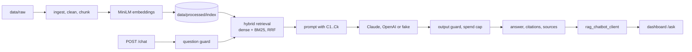
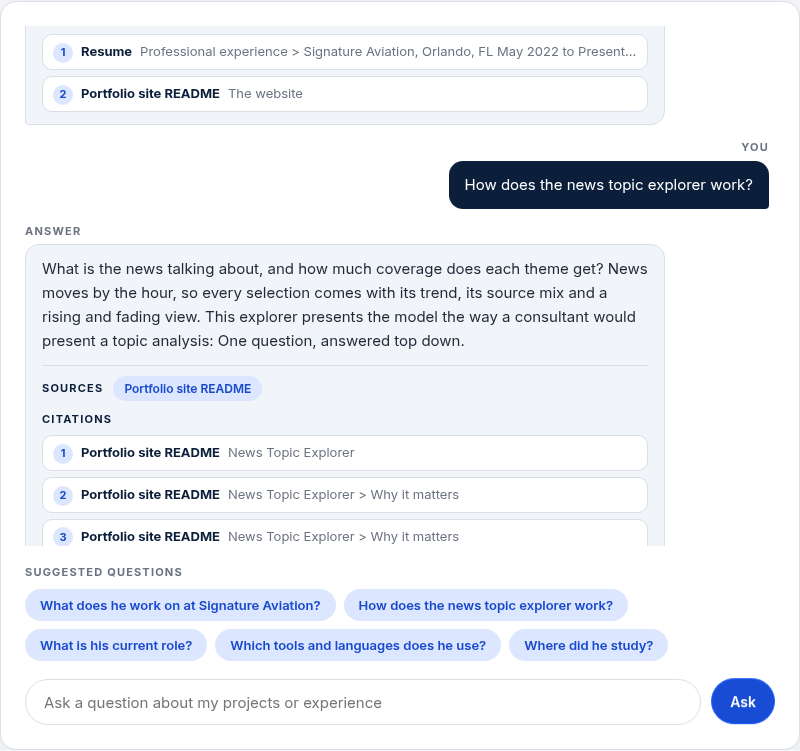

# RAG Chatbot

A retrieval augmented chatbot that answers questions about my projects and
experience. It reads my resume and project READMEs, splits them into
passages, indexes them for hybrid search, and has a language model answer
from the retrieved passages only, with numbered citations. It runs as one
small FastAPI service and ships with an httpx only client that my portfolio
dashboard uses for its Ask page.





More detail in [docs/architecture.md](docs/architecture.md). Deployment steps
are in [docs/deployment.md](docs/deployment.md).

## Layout

```
rag-chatbot/
  configs/              settings.toml (models, chunking, retrieval, guardrails, api), sources.toml
  data/
    raw/                source documents, filled by `make sources`, not committed
    processed/index/    chunks.json, vectors.npy, manifest.json (committed)
  deploy/huggingface/   Space card with the Docker front matter
  docs/                 architecture, deployment, screenshots
  evaluation/           retrieval_eval.json (34 questions) and results/
  scripts/              push_to_space.sh, smoke_test.py
  src/
    rag_chatbot/
      api/              FastAPI app, routes, schemas, API key guard
      chat/             ChatService (the RAG loop), RagRuntime, fixed replies
      chunking/         Chunk, HeadingAwareChunker
      cli/              rag-chatbot sources | index | serve | eval
      config/           settings dataclasses
      embeddings/       sentence transformer and offline fake
      evaluation/       recall at k, MRR, off topic rejection
      guardrails/       contact scrubbing, question and output guards, spend cap
      index/            vector store, manifest, builder
      ingestion/        PDF, Markdown and Python readers, cleaning, deduplication
      llm/              AbstractChatProvider, Anthropic, OpenAI, fake, pricing
      prompts/          PromptBuilder
      retrieval/        BM25, query expansion, RRF, reranker, HybridRetriever
    rag_chatbot_client/ httpx only client
  tests/
    unit/               every package, plus repository rules
    integration/        the API and the client through FastAPI's TestClient
  Dockerfile  Makefile  pyproject.toml  render.yaml  .env.example
```

## Quick start

```bash
python -m venv .venv && source .venv/bin/activate
make install          # CPU torch, then the server, client and dev tools
make test lint
make serve-fake       # http://127.0.0.1:8070 with the offline model, no key needed
make smoke            # one question through the client
```

With a key, the same service answers with Claude Sonnet 5.5:

```bash
cp .env.example .env  # add ANTHROPIC_API_KEY, then
set -a; source .env; set +a
make serve
```

## Rebuilding the index

```bash
make sources          # copy the documents from the sibling repositories into data/raw
make index            # rebuilds only when a document, the model or a chunk setting changed
make eval             # recall at k and MRR, written to evaluation/results/
```

The build removes phone numbers and email addresses before
anything is embedded and fails if any survive. `configs/sources.toml` lists
the documents in priority order, the sections to skip, and text corrections.

## Models

| Setting | Default | Change with |
| --- | --- | --- |
| Provider | auto: Anthropic if its key is set, then OpenAI, else fake | `LLM_PROVIDER` |
| Anthropic model | claude-sonnet-5-5 | `LLM_MODEL` or `[llm] anthropic_model` |
| OpenAI model | gpt-6-astra | `LLM_MODEL` or `[llm] openai_model` |
| OpenAI compatible server | none | `LLM_BASE_URL` (Hugging Face Inference Endpoints, vLLM) |
| Embedding model | sentence-transformers/all-MiniLM-L6-v2, 384 dimensions, CPU | `[embedding]` then `make index` |
| Reranker | cross-encoder/ms-marco-MiniLM-L6-v2, off | `RERANK=true` |

A new provider is one class that implements `AbstractChatProvider.complete`
and one line in `ProviderFactory`.

## API

| Route | Body | Returns |
| --- | --- | --- |
| `POST /chat` | `{"question": "...", "history": [{"role", "content"}], "top_k": 5}` | `answer`, `status`, `citations`, `sources`, `provider`, `model` |
| `POST /retrieve` | `{"query": "...", "top_k": 5, "mode": "hybrid"}` | ranked passages with dense, BM25 and fused scores |
| `GET /health` | | index version and chunk count (always open) |
| `GET /info` | | models, chunking, retrieval settings, spend cap state |

Interactive docs are served at `/docs`:


`status` is one of `answered`, `not_covered`, `declined`, `blocked`, `budget`
or `error`. When `CHATBOT_API_KEY` is set, every route but `/health` needs it
in `X-API-Key` or `Authorization: Bearer`.

## Client

```bash
pip install "rag-chatbot @ git+https://github.com/ajgeiger/rag-chatbot"   # httpx only
```

```python
from rag_chatbot_client import ChatbotClient, ChatbotError

client = ChatbotClient("http://127.0.0.1:8070", api_key="")
try:
    response = client.chat("What does he work on at Signature Aviation?")
    print(response.answer)
    for citation in response.citations:
        print(citation.number, citation.source, citation.section)
except ChatbotError as error:
    print("outage" if error.is_outage else f"refused: {error.status_code}")
```

## Retrieval quality

34 questions with labeled sections (29 answerable, 5 off topic), index
d272655ade5d, 50 chunks:

| Mode | Recall@1 | Recall@3 | Recall@5 | MRR | Off topic rejected |
| --- | --- | --- | --- | --- | --- |
| BM25 | 0.759 | 0.966 | 1.000 | 0.865 | 1.00 |
| Dense | 0.724 | 0.793 | 0.828 | 0.760 | 1.00 |
| Hybrid (default) | 0.828 | 0.966 | 1.000 | 0.894 | 1.00 |
| Hybrid + rerank | 0.897 | 1.000 | 1.000 | 0.943 | 1.00 |

## Guardrails

- Questions about job status, salary or contact details get a fixed reply with no model call.
- Questions that retrieve nothing get "not covered" with no model call.
- Answers that contain a phone number, an email address or job seeking language are blocked; dashes and emoji are removed.
- A monthly spend cap stops model calls once reached (`MONTHLY_BUDGET_USD`, default 20).

## Deploying on Render

The repo root has a `render.yaml` for a Starter Docker web service named
`rag-chatbot`. It builds the existing Dockerfile. Render sets `PORT`; the
image falls back to 7860 if it is unset. The health check is `GET /health`.

In the Render dashboard, create a Blueprint from this repository (or add a
Docker web service pointed at it). Fill in `ANTHROPIC_API_KEY` and
`CHATBOT_API_KEY` when asked. `MONTHLY_BUDGET_USD` is already set to 20.

The spend tracker writes to `/tmp` and resets when the service restarts, so
also set a monthly cap in the Anthropic console. The committed index is read
at startup and does not need a disk.

Once it is live, set the dashboard's `CHATBOT_API_URL` to the
`onrender.com` address and use the same `CHATBOT_API_KEY`.

## Hosting

The Dockerfile is also built for a Hugging Face Docker Space: user 1000,
port 7860, CPU torch, the embedding model downloaded at build time. See
[docs/deployment.md](docs/deployment.md).
