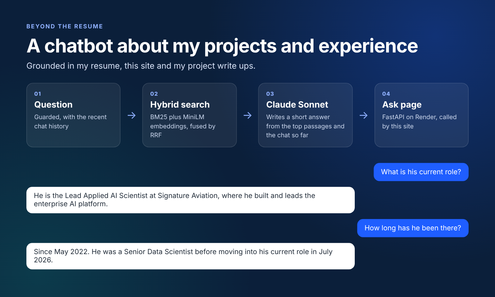
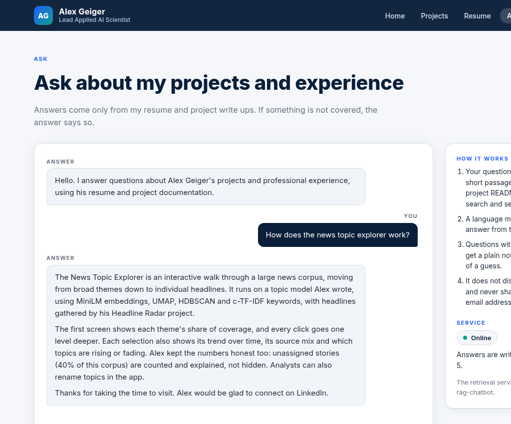
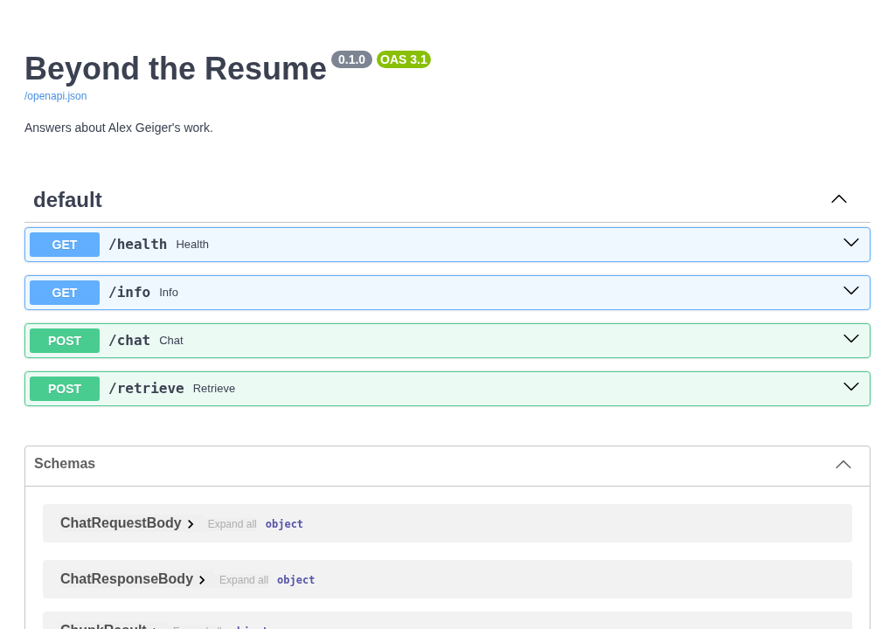

# Beyond the Resume



**Try it live:** ask it a question on the [Ask page at ajgeiger.com](https://ajgeiger.com/ask).
The project write up is at [ajgeiger.com/projects/rag-chatbot](https://ajgeiger.com/projects/rag-chatbot).

A chatbot you can ask about my experience, skills and projects. It searches my
resume and my project write ups with keyword and semantic search together,
then Claude Sonnet answers from what it found.

It runs as a small FastAPI service. The Ask page on
[ajgeiger.com](https://ajgeiger.com/ask) calls it through the httpx client in
this repo.



The repo was renamed from rag-chatbot. The Python package, the command line
tool and the Render service are still called `rag-chatbot`.

## How it works

Building the index (`make sources`, then `make index`):

1. The source documents are copied into `data/raw` from my other repos:
   the resume PDF and its build script, the portfolio site's README, home,
   projects and resume pages, the project write ups, the Headline Radar and
   natural gas forecasting READMEs, and `docs/portfolio_site_pages.md`.
   `configs/sources.toml` lists them in priority order.
2. Each file type has its own reader. The PDF reader splits the resume by
   heading and by role, the Markdown reader splits by heading, and the Python
   reader keeps only the string literals that read like sentences. Sections
   about setup and running code are skipped, a few out of date phrases are
   corrected, and near duplicate paragraphs are dropped so the earlier source
   wins.
3. Phone numbers and email addresses are removed. The build fails if any are
   left.
4. Sections are cut into chunks of up to 160 tokens with 32 tokens of
   overlap. A chunk never crosses a heading.
5. Chunks are embedded with all-MiniLM-L6-v2 (384 dimensions, run with ONNX
   Runtime on CPU) and saved to `data/processed/index`. The index is committed,
   so serving never needs the source documents. The build is skipped when the
   documents, model and chunk settings have not changed.

Answering a question (`POST /chat`):

1. A question guard returns a fixed reply, with no model call, for empty or
   overly long questions, pay and job status questions, and requests for
   contact details. Simple greetings also get a fixed reply.
2. Follow up questions such as "How long has he been working on that?" are
   rewritten into a standalone search query. With an Anthropic key this is a
   short Claude Haiku call, made only when there is history and the question
   looks like a follow up. Otherwise a free rule based rewrite prepends the
   previous question. The rewrite is only used for search. The answer model
   still sees the original question.
3. Hybrid retrieval scores every chunk with cosine similarity and BM25, then
   merges the two rankings with reciprocal rank fusion. A chunk only counts if
   it clears a minimum dense similarity (0.32) or BM25 score (3.5), so an off
   topic question finds nothing. A cross encoder reranker is available but off
   by default.
4. If nothing is found, the reply is a fixed "not covered" message. The
   exception is questions about how he works or what he would bring to a team,
   which still go to the model.
5. Claude Sonnet gets fixed instructions, the retrieved passages labeled C1,
   C2 and so on, the last 10 turns of history, and the question. The
   instructions are cached with Anthropic prompt caching. Thinking is turned
   off for these short answers, and an answer that still reaches the token
   limit is cut back to its last full sentence.
6. An output guard blocks answers that contain contact details, job seeking
   language or pay talk, and tidies the rest (long dashes and emoji removed,
   the graduate school always named Syracuse University). A thank you or
   LinkedIn line is removed unless the visitor greeted or thanked the bot.
7. The response includes the answer, a status, and citations. The model is
   told not to show citation tags, so the citations are normally the top three
   retrieved passages. The Ask page does not display them.

A monthly spend cap (20 USD by default) covers both the answer and rewrite
calls. Once it is reached, questions get a fixed reply until the next month.

## Project layout

```
configs/              settings.toml (models, chunking, retrieval, guardrails, api), sources.toml
data/
  raw/                source documents, filled by `make sources`, not committed
  processed/index/    chunks.json, vectors.npy, manifest.json (committed)
deploy/huggingface/   Space card for a Hugging Face Docker Space
docs/                 architecture, deployment, site pages text, screenshots
evaluation/           retrieval_eval.json (34 labeled questions) and results/
scripts/              download_embedding_model.py, push_to_space.sh, smoke_test.py
src/
  rag_chatbot/
    api/              FastAPI app, routes, schemas, API key check
    chat/             ChatService (the answer loop), RagRuntime, fixed replies
    chunking/         HeadingAwareChunker
    cli/              rag-chatbot sources | index | serve | eval
    config/           settings dataclasses
    embeddings/       ONNX MiniLM, optional sentence-transformers, offline fake
    evaluation/       recall at k, MRR, off topic rejection
    guardrails/       contact scrubbing, question and output guards, spend cap
    index/            vector store, manifest, builder
    ingestion/        PDF, Markdown and Python readers, cleaning, deduplication
    llm/              Anthropic, OpenAI and fake providers, pricing
    prompts/          PromptBuilder
    retrieval/        BM25, query expansion, fusion, reranker, HybridRetriever
    rewrite/          follow up query rewriting (Claude and rule based)
  rag_chatbot_client/ httpx only client used by the portfolio site
tests/
  unit/               each package, plus repository rules
  integration/        the API and the client through FastAPI's TestClient
Dockerfile  Makefile  pyproject.toml  render.yaml  .env.example
```

## Running locally

Python 3.11 or newer.

```bash
python -m venv .venv && source .venv/bin/activate
make install          # pip install -e ".[server,dev]"
make download-model   # MiniLM ONNX export into models/, once
make serve-fake       # http://127.0.0.1:8070 with the offline fake model, no key needed
make smoke            # ask the running service one question through the client
```

The fake model answers by quoting the best matching passages, which is enough
to check retrieval. To get real answers from Claude:

```bash
cp .env.example .env  # add ANTHROPIC_API_KEY
set -a; source .env; set +a
make serve
```

Interactive API docs are at http://127.0.0.1:8070/docs.

To rebuild the index after a source changes, clone my other repos next to
this one (or set `SOURCE_ROOT`), then:

```bash
make sources          # copy the documents into data/raw
make index            # rebuild when a document or setting changed (index-force to always rebuild)
make eval             # recall at k and MRR, written to evaluation/results/
```

## API

| Route | Body | Returns |
| --- | --- | --- |
| `POST /chat` | `{"question": "...", "history": [{"role": "user", "content": "..."}], "top_k": 8}` | `answer`, `status`, `citations`, `sources`, `provider`, `model`, `index_version`, `took_ms` |
| `POST /retrieve` | `{"query": "...", "top_k": 5, "mode": "hybrid"}` | ranked passages with dense, BM25 and fused scores, no model call |
| `GET /health` | | index version and chunk count, always open |
| `GET /info` | | models, chunking, retrieval settings, spend cap state |



`status` is one of `answered`, `not_covered`, `declined`, `blocked`, `budget`
or `error`. `history` takes up to 20 messages, oldest first. When
`CHATBOT_API_KEY` is set, every route except `/health` needs it in `X-API-Key`
or `Authorization: Bearer`.

## Client

The base install has only httpx, so the portfolio site can call the service
without the server dependencies.

```bash
pip install "rag-chatbot @ git+https://github.com/ajgeiger/Beyond-the-Resume"
```

```python
from rag_chatbot_client import ChatbotClient, ChatbotError

client = ChatbotClient("http://127.0.0.1:8070", api_key="")
try:
    first = client.chat("What does he work on at Signature Aviation?")
    history = [
        {"role": "user", "content": "What does he work on at Signature Aviation?"},
        {"role": "assistant", "content": first.answer},
    ]
    follow_up = client.chat("What tools does he use for that?", history)
    print(follow_up.answer)
except ChatbotError as error:
    print(error)
```

On the site, the Ask page keeps the conversation in the page (it resets on reload) and
sends the last 10 turns with each question.

## Configuration

Defaults live in `configs/settings.toml`. These environment variables override
them (see `.env.example`):

| Variable | Default | Purpose |
| --- | --- | --- |
| `ANTHROPIC_API_KEY` | | Claude writes the answers and rewrites follow ups |
| `OPENAI_API_KEY` | | used when `LLM_PROVIDER=openai`, or when no Anthropic key is set |
| `LLM_PROVIDER` | `auto` | `anthropic`, `openai`, `fake` or `auto` (Anthropic, then OpenAI, then fake) |
| `LLM_MODEL` | `claude-sonnet-5-5` | answer model for the active provider |
| `LLM_REWRITE_MODEL` | `claude-haiku-5-5` | model for follow up rewriting |
| `LLM_BASE_URL` | | any OpenAI compatible server, with `LLM_PROVIDER=openai` |
| `MAX_OUTPUT_TOKENS` | `1024` | answer length limit |
| `MONTHLY_BUDGET_USD` | `20` | spend cap per calendar month |
| `USAGE_FILE` | `data/usage.json` | where monthly spend is recorded |
| `CHATBOT_API_KEY` | | require a key on the protected routes |
| `HOST`, `PORT` | `127.0.0.1`, `8070` | where the API listens |
| `RERANK` | `false` | turn on the cross encoder reranker (needs `make install-torch`) |
| `EMBEDDING_MODEL_DIR` | `models/all-MiniLM-L6-v2` | folder with the ONNX model and tokenizer |
| `CONFIG_PATH`, `INDEX_DIR` | | use a different settings file or index folder |

## Tests

```bash
make test             # pytest, unit and integration
make lint             # ruff check and format check
```

The tests use the fake embedding model and the fake language model, so they
need no keys or downloads. They also check repository rules, such as no long
dashes in any file and no contact details in the committed index. CI runs
lint and tests on Python 3.12, and checks that the client installs with httpx
only on Python 3.11.

`evaluation/results/retrieval_eval_results.json` is the last saved retrieval
evaluation, run on the current index. Run `make eval` again after rebuilding.

## Deployment

The service runs on Render as a Docker web service. `render.yaml` defines a
Starter plan service named `rag-chatbot` that builds the Dockerfile, with
`GET /health` as the health check. Set `ANTHROPIC_API_KEY` and
`CHATBOT_API_KEY` when Render asks. `MONTHLY_BUDGET_USD` is set to 20.

The image installs the server extras, bakes in the MiniLM ONNX model at build
time, and copies the committed index, so it starts offline and needs no disk.
Render sets `PORT`; the image falls back to 7860. Spend tracking is written to
`/tmp` and resets on restart, so it is worth also setting a monthly limit in
the Anthropic console.

The portfolio site needs `CHATBOT_API_URL` set to the service address and the
same `CHATBOT_API_KEY`.

The same image can also run on a Hugging Face Docker Space as an optional
second host, with `make space-push SPACE_ID=user/name`. See
[docs/deployment.md](docs/deployment.md) and
[docs/architecture.md](docs/architecture.md) for more detail.
