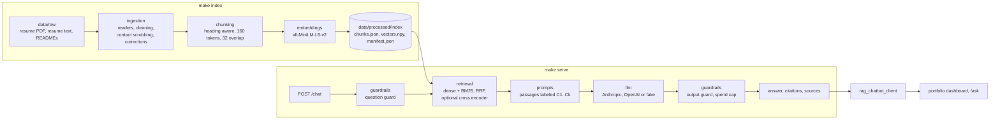

# Architecture

## Flow

## Packages

| Package | Responsibility |
| --- | --- |
| `config` | Dataclasses for every setting, loaded from `configs/*.toml` with environment overrides. |
| `ingestion` | One reader per file type (PDF, Markdown, Python text), cleaning, paragraph deduplication across sources. |
| `chunking` | `Chunk` and `HeadingAwareChunker`: sentence units packed to a token budget with overlap, never across sections. |
| `embeddings` | `AbstractEmbeddingModel` with the sentence transformer and an offline hashing model for tests. |
| `index` | `VectorStore` (exact cosine over numpy), `IndexManifest` (fingerprint of sources and settings), `IndexBuilder`. |
| `retrieval` | `Bm25Index`, `QueryExpander`, `ReciprocalRankFusion`, `CrossEncoderReranker`, `HybridRetriever`. |
| `prompts` | `PromptBuilder`: fixed rules first (cacheable), then the retrieved passages, then the question. |
| `llm` | `AbstractChatProvider` and the Anthropic, OpenAI and fake providers, `ProviderFactory`, pricing and token usage. |
| `guardrails` | `ContactScrubber`, `QuestionGuard`, `OutputGuard`, `CostTracker`. |
| `chat` | `ChatService` (the RAG loop), `RagRuntime` (loads everything once), `ChatCopy` (fixed replies). |
| `api` | FastAPI routes, request and response schemas, the API key guard. |
| `evaluation` | Recall at k, MRR and off topic rejection over `evaluation/retrieval_eval.json`. |
| `cli` | `rag-chatbot sources | index | serve | eval`. |
| `rag_chatbot_client` | The httpx only client. A separate top level package so callers install no server dependencies. |

## Decisions

- **Hybrid retrieval.** BM25 catches exact names (HDBSCAN, Signature Aviation)
  that the small embedding model blurs; dense search catches paraphrases.
  Reciprocal rank fusion merges the two lists without tuning score scales.
- **Relevance bars.** A dense similarity of 0.35 or a BM25 score of 3.5 is
  required, so off topic questions retrieve nothing and never reach the model.
- **Role level sections.** The resume PDF is split per role with titles such
  as `Professional experience > Signature Aviation, Orlando, FL > Lead Applied
  AI Scientist Jul 2026 to Present`, and the header block is titled `Name and
  current title`. Section titles are part of the embedded text and get double
  weight in BM25, which is what lets "What is his current role?" find the
  right passage.
- **Committed index.** The index is small (about 100 KB) and contains no
  contact details (the build fails if any survive scrubbing), so it is
  committed. Deployment never needs the source documents, and `data/raw` stays
  out of git.
- **Rebuild only on change.** The manifest fingerprints the source file
  hashes, the model, the chunk settings, the corrections and the pipeline
  version. `make index` does nothing when the fingerprint matches.
- **Provider neutral prompts.** A provider receives a `ChatRequest` and
  returns a `ChatReply`. Changing model or vendor is configuration:
  `LLM_PROVIDER`, `LLM_MODEL`, `LLM_BASE_URL`.
- **Cost control.** Guarded, empty and over budget requests return fixed
  text without a model call. Unknown models are priced at the highest known
  rate until a price is added to `[llm.pricing]`.
